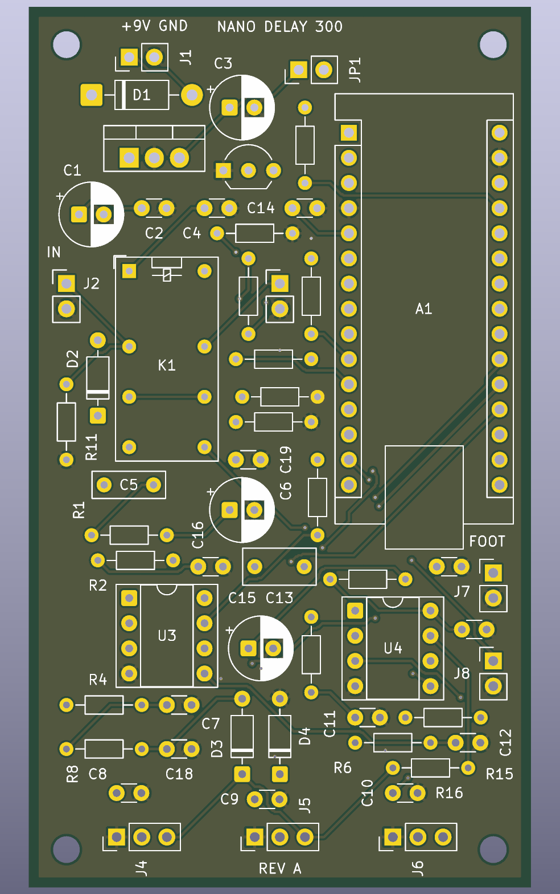

# Arduino Nano Delay Pedal

A compact guitar delay pedal prototype built around a classic Arduino Nano, with a **300 ms delay target**. The schematic and two-layer PCB are complete as a first hardware draft. **Firmware has not been developed, the circuit has not been built or tested, and the enclosure fit is not confirmed.**

## Hardware

- **50.8 × 88.9 mm**, two-layer PCB with four M2.5 mounting holes.
- Socketed Arduino Nano and through-hole components.
- **23LC1024-I/P SPI SRAM** for the planned delay buffer. At 16 ksample/s with 8-bit mono samples, 300 ms requires 4,800 bytes, exceeding the Nano's built-in RAM.
- **MCP6002-I/P** audio buffers on filtered 5 V, with a 2.5 V input bias and approximately 2.7 kHz input/output filter bandwidth.
- **G5V-2-H1 DC5** relay for true bypass; the unpowered/default state is bypass.
- Wired time, feedback and mix pots, audio jacks, momentary footswitch, LED and 9 V power jack.

This is a lo-fi delay design. The external SRAM provides storage; the Nano still performs sampling, delay, mixing, feedback and PWM output. The target delay and audio performance remain to be demonstrated in firmware and bench tests. Board dimensions are intended for a compact pedal; they do not guarantee compatibility with a specific BOSS enclosure.

## Open the project

Open [delay-pedal.kicad_pro](delay-pedal.kicad_pro) in **KiCad 9 or later**. The root schematic and PCB belong to the same revision. The project-local SRAM symbol is included in `Delay.kicad_sym` and `sym-lib-table`.

| File / folder | Contents |
|---|---|
| [delay-pedal.kicad_sch](delay-pedal.kicad_sch) | Updated circuit schematic |
| [delay-pedal.kicad_pcb](delay-pedal.kicad_pcb) | Fully routed PCB with ground pours |
| [delay-pedal.pdf](delay-pedal.pdf) | Schematic PDF |
| [Assembly map](docs/assembly-top.pdf) | Component locations, including references printed on the reverse |
| [Parts list](docs/parts-list.md) | Values, package dimensions and off-board hardware |
| [Hardware and wiring guide](docs/hardware-guide.md) | Pin assignments, assembly, USB power and first checks |
| [Validation reports](docs/checks/) | KiCad ERC, DRC and schematic/PCB agreement results |
| [Prototype manufacturing files](manufacturing/) | Gerbers and separate plated/non-plated Excellon drill files |

## Power and wiring

Use a **regulated 9 V pedal adapter**. For a center-negative jack, wire its center contact to J1 pin 2 (ground) and its outer contact to J1 pin 1 (+9 V). The jack is mounted off-board.

**Remove the JP1 shunt before connecting USB.** For programming, disconnect 9 V, remove JP1, then connect USB. After programming, disconnect USB, refit JP1 and reconnect 9 V. See the [hardware guide](docs/hardware-guide.md) for the complete procedure and wiring table.

Use three **B10k linear pots** and a **normally-open momentary footswitch**. Verify purchased component dimensions, pinouts and connector polarity against the footprints before assembly. U3 uses MCP6002, not the TL072 from the initial schematic.

## Validation and status

The delivered revision passes KiCad's electrical and PCB design checks with **zero reported violations, zero unconnected pads and zero schematic/PCB agreement issues**. Reports are saved in [docs/checks](docs/checks/). These checks establish CAD consistency; they do not establish functional audio performance.

- [x] Review and revise the schematic
- [x] Add external SRAM and correct input bias and relay protection
- [x] Assign footprints and complete the first PCB layout
- [x] Run KiCad ERC, DRC and schematic/PCB agreement checks
- [x] Export prototype manufacturing files and assembly documentation
- [ ] Confirm supplier part numbers and final enclosure/height clearances
- [ ] Build and power-check a prototype
- [ ] Develop and validate the Arduino firmware
- [ ] Measure delay range, noise, clipping and feedback behavior
- [ ] Test relay switching and revise the hardware as needed

The manufacturing exports are for this **unvalidated prototype**, not a tested production release. Validate the circuit and mechanical fit before ordering a production batch. Older schematic revisions are retained in Git history.

## License

See [LICENSE](LICENSE).
